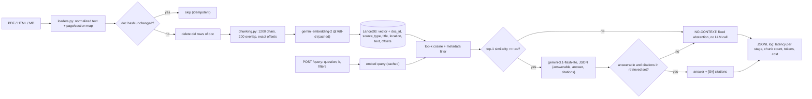

# Problem 1 — Cost-Efficient RAG Application

QA over an 8-document corpus (PDF / Markdown / HTML) using an **embedded LanceDB** store (no always-on server), Gemini embeddings and generation, and a FastAPI endpoint. Evaluation covers three layers: retrieval, answers, and cost + latency.

Tags: **[MEASURED]** = from our runs (files in `results/`); **[PROJECTED]** = public prices × stated assumptions.

## Architecture



## Setup and run (Windows PowerShell, Python 3.11)

```powershell
cd problem1-rag
..\.venv\Scripts\python -m pip install -r requirements.txt
# repo-root .env must contain GEMINI_API_KEY (names of all variables: .env.example)
..\.venv\Scripts\python -m rag ingest                       # default chunk 1200 chars / overlap 200; re-run = no new vectors
..\.venv\Scripts\python -m rag query "What are the typical root causes of Excessive Agency?" --filter source_type=md
..\.venv\Scripts\python -m rag serve                         # http://127.0.0.1:8000/docs  (POST /query, GET /stats)
..\.venv\Scripts\python -m pytest -q                         # 35 offline tests, no API key needed
..\.venv\Scripts\python -m eval.run_eval all --offline       # rebuild every results table from committed caches
..\.venv\Scripts\python -m eval.latency_bench                # retrieval latency (no API)
..\.venv\Scripts\python -m eval.cost_model                   # cost table
```

`POST /query` takes `{"question": str, "k": 1-20, "filters": {"source_type"|"doc_id": value}}`. It returns the answer, `abstained`, citations (doc, page/section, chunk id, score), `latency_ms` per stage, `chunk_count`, `tokens` and `cost_usd`.

- **Configuration:** all settings come from env vars (`.env.example`); there are no secrets in code.
- **Spend cap:** a hard budget cap (`BUDGET_USD=1.5` for P1, so P1 + P2 ≤ $5) is checked before every API call.
- **Caching:** every embedding and LLM response is cached (`cache/`), so a re-run costs nothing and replays offline.

## Corpus and questions

- **Corpus:** 8 pinned documents, 3.8 MB in total: 2 NIST PDFs, 4 OWASP LLM Top-10 Markdown files, and 2 OWASP web pages (HTML). Metadata, URLs, licenses and sha256 hashes are in `data/corpus/sources.json` and [`SOURCES.md`](data/corpus/SOURCES.md). Wikipedia was dropped because its robot policy blocks scripted downloads (HTTP 403).
- **Eval set** (`eval/questions.jsonl`): **18** questions — 6 single-fact, 3 paraphrased, 3 multi-span, 2 filter-scoped and 4 unanswerable.
- **Dev set** (`eval/dev_questions.jsonl`): 5 questions, used **only** to choose τ.
- **Validation:** `eval/validate_questions.py` checks mechanically that:
  - every gold quote appears verbatim in the extracted text;
  - every gold answer lies inside its evidence;
  - paraphrased questions share ≤ 25% of their content words with their evidence;
  - each filter actually excludes an on-topic document;
  - unanswerable topics are absent from the corpus;
  - dev and eval share no evidence.
- **Relevance:** a chunk is relevant if it covers ≥ 50% of a gold evidence span. This is computed on character offsets, so it holds for any chunk size.

## Results

### Retrieval [MEASURED] — [`results/retrieval.md`](results/retrieval.md)

14 answerable questions, k = 5, mean [95% bootstrap CI]:

| Chunk (chars) | Vectors | Hit@5 | Recall@5 | MRR | nDCG@5 | Context precision P@5 | Context tokens/query |
|---|---|---|---|---|---|---|---|
| **1200/200 (default)** | 356 | 0.786 [0.57, 1.00] | 0.750 [0.54, 0.93] | 0.649 [0.42, 0.86] | 0.650 [0.43, 0.85] | 0.171 [0.11, 0.23] | 1340 |
| 2400/400 | 193 | 0.857 [0.64, 1.00] | 0.821 [0.61, 1.00] | 0.768 [0.55, 0.95] | 0.754 [0.55, 0.92] | 0.200 [0.14, 0.26] | 2536 |

### Answers [MEASURED] — [`results/answers.md`](results/answers.md)

18 questions, k = 5. The judge is `gemini-3.6-flash`; a claim counts as supported only if its quote is verified in the context by code.

| Faithfulness | Answer relevance | EM | F1 | Contains gold | Citation precision | Correct abstention | False abstention |
|---|---|---|---|---|---|---|---|
| 1.000 (12 answered) | 1.000 | 0.000 | 0.310 [0.19, 0.43] | 0.571 [0.29, 0.79] | 0.611 [0.44, 0.79] | 4/4 | 2/14 |

### Latency [MEASURED] — [`results/latency.md`](results/latency.md)

Measured on an i5-13450HX laptop (16 threads), local SSD, k = 5.

| Retrieval setting | p50 ms | p95 ms |
|---|---|---|
| Real corpus (356 rows, exact scan) | 6.99 | 8.28 |
| 100K synthetic, exact scan | 210.48 | 225.74 |
| 100K synthetic, IVF-PQ (recall@10 0.134 on random vectors) | 9.33 | 11.48 |

End-to-end (live run; query embedding + retrieval + generation): p50 6,040 ms, p95 53,748 ms. This is n = 12, and the p95 is driven by API retry/back-off on a free-tier, high-demand day.

### Cost [PROJECTED] — [`results/cost_table.md`](results/cost_table.md)

Baseline of 50K queries/month:

| Vectors | Self-hosted LanceDB $/mo | Pinecone Standard $/mo |
|---|---|---|
| 100K | 26.14 | 50.00 (minimum) |
| 1M | 26.22 | 50.00 (minimum) |
| 10M | 83.99 | 52.27 |

At 1M queries/month, Pinecone costs $64.96 for 1M vectors and $649.61 for 10M vectors, while self-hosted stays at $26.22 and $83.99.

All assumptions (prices with sources, the instance sizing rule, 5% monthly churn, 1 replica) are listed in the cost file. The AWS prices are marked as unverified assumptions.

## Design decisions

- **LanceDB:**
  - It's an embedded library: `pip install`, no server, and Docker isn't needed (it isn't installed here).
  - It has an SQL-like metadata `where` filter and a `merge_insert` upsert.
  - Data sits in files on disk or object storage, so cost follows storage rather than always-on pods.
  - Rejected: Qdrant and pgvector (each needs a server); Chroma (in-memory HNSW is RAM-heavy at 10M); FAISS (no metadata, no persistence); sqlite-vec (brute-force scan).
- **Chunking 1200/200 characters (~300/50 tokens):**
  - Splits recursively on paragraph → line → sentence → word, with exact offsets.
  - 2400/400 retrieves better (Hit@5 +0.07, MRR +0.12) but sends 1.9× more context tokens per query. Since generation cost is linear in context, we kept 1200 as the default; 2400 is the better option if cost doesn't matter.
  - A 600/100 setting was planned but **not measured**: the free-tier embedding quota ran out (1,000 texts/day), which also forced the switch below.
- **Embeddings, `gemini-embedding-2` @ 768-d:**
  - 768-d is a quarter of the 3072-d storage cost.
  - It replaced `gemini-embedding-001` after that model's free daily quota was exhausted (user-approved).
  - Documents use the `title: none | text:` prefix and queries use `task: search result | query:`.
- **No relevant context:**
  1. A similarity gate τ = 0.6756, set from the dev set as "lowest answerable top-1 similarity − 0.02". It is a cheap pre-filter.
  2. The model must return `answerable=false` when the sources don't contain the answer.
  3. Answers without a valid `[S#]` citation into the retrieved set become a fixed abstention.

  Result: 4/4 unanswerable questions abstained. However, the gate also blocked 2 answerable questions (q04 at similarity 0.666, q09 at 0.671), so it costs recall.
- **Idempotent re-ingest:**
  - `doc_id` is a stable slug, and `chunk_id = sha256(doc | config | offset | text)`.
  - A per-table manifest of document text hashes means unchanged documents are skipped. A changed document is deleted, then re-inserted via `merge_insert` on `chunk_id`.
  - The manifest is written only after the store write succeeds.
  - Test: ingesting twice gives the same count (356 → 356), and an edited document re-embeds only itself.

## Discussion

**Was retrieval or generation the weak link? Retrieval.**
- Every one of the 12 answered questions was judged fully faithful, with each claim's quote verified in the context.
- Retrieval missed the gold evidence entirely for 3/14 questions at 1200/200 (q04, q07, q09) and 2/14 at 2400/400. **Both paraphrased-question misses (q07, q09) persist at both sizes**: dense retrieval struggles when the question avoids the document's wording.
- Both false abstentions also came from the retrieval-side similarity gate, not from the generator.
- Caveats:
  - The judge is from the same model family as the generator, so faithfulness could be lenient. The code-verified quotes and citation precision (0.61, below 1.0 partly because several chunks restate the same fact) are the non-LLM cross-checks.
  - EM is 0 because answers are full sentences; F1 and contains-gold are the more informative metrics.
- Next fixes: hybrid BM25 + dense retrieval or query rewriting for paraphrases, and dropping or lowering τ in favour of the LLM's `answerable` flag.

**When would we switch back to a managed DB?**
- In this cost model, self-hosting wins at 100K–1M vectors (about $26 vs Pinecone's $50 minimum).
- At 10M vectors with light traffic (50K queries/month), Pinecone serverless is cheaper ($52 vs $84 for a 16 GiB node). So a very large, rarely-queried index is the case where managed wins, unless we move LanceDB onto object storage with scale-to-zero compute (not measured here).
- Managed costs grow with traffic × namespace size: at 1M queries/month and 10M vectors it projects to about $650/mo vs $84 self-hosted.
- We would also switch back for operational reasons: when we need HA or replication, multi-tenant isolation, many concurrent writers, or a team without capacity to run and patch a database.
- **Trade-offs we accept:** single-writer embedded storage, no built-in HA (snapshots to S3 instead), and ANN tuning left to us — IVF-PQ recall@10 was only 0.13 on random 100K vectors at nprobes = 20, so real data needs a recall/latency sweep before 10M.

## Tests

`pytest -q` runs 35 offline tests: loaders, corpus integrity, question validity, chunking, **idempotent ingest**, answer/abstain/citation logic, metadata filtering with injection rejection, IR and answer metrics against hand-computed values, and **cache hits plus the budget cap**.
