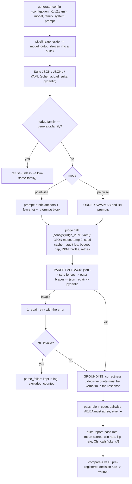

# Problem 2 — LLM-as-Judge Evaluation Pipeline

A test suite (JSON / JSONL / YAML) goes in; structured verdicts and a suite report come out. The pipeline handles malformed JSON, logs every prompt and raw response, compares two configs and declares a winner, and **measures five judge biases, before vs after mitigation**.

Tags: **[MEASURED]** = from our runs; every number in `results/` is regenerated from `cache/calls.jsonl` with `--offline`.

## Architecture



## Setup and run (Windows PowerShell, Python 3.11)

```powershell
cd problem2-llm-judge
..\.venv\Scripts\python -m pip install -r requirements.txt
# repo-root .env: GEMINI_API_KEY (all variable names: .env.example)
..\.venv\Scripts\python -m judge run --suite suites/demo.yaml                 # suite in -> results/run_demo_judge_v1.{md,json}
..\.venv\Scripts\python -m judge compare --a suites/ab_gen_v1.jsonl --b suites/ab_gen_v2.jsonl
..\.venv\Scripts\python -m judge experiments --offline                      # rebuild every bias/validation/A-B table from the log
..\.venv\Scripts\python -m judge show --pair f1-T-vs-VW                      # raw judge prompt + raw response, both orders
..\.venv\Scripts\python -m pytest -q                                         # offline tests
```

- **Independent configs:** judge and generator are configured separately, `configs/judge_v0.yaml` / `judge_v1.yaml` vs `configs/gen_v1.yaml` / `gen_v2.yaml`. Each has a `model` and a `family`.
- **Models:**
  - judge: `gemini-3.5-flash-lite` (family gemini). It replaced `gemini-3.6-flash`, whose free tier allows only 20 requests/day;
  - generator: `gemma-4-31b-it` (family gemma).
- **Spend cap:** a hard budget cap (`BUDGET_USD=3.5`) is checked before every call.
- **Audit log:** every call is appended to `cache/calls.jsonl` with tag, model version, system prompt, full prompt, raw text, tokens, cost and latency. It is committed, so all results can be audited and replayed.

## Judging design

**Modes:** pointwise and pairwise.

| Mode | When it fits | Used here for |
|---|---|---|
| Pointwise, reference-based | a gold answer exists (facts, math, extraction) | probe suite, A/B pass rates |
| Pointwise, reference-free | open-ended tasks; gating on an absolute bar | supported (e.g. `free-1` in the demo suite) |
| Pairwise A-vs-B | choosing between two configs; small differences; robust to score clustering | position/verbosity probes, A/B win rate |

**Rubric** (`judge/rubric.yaml`): 1–5 with anchors at 1, 3 and 5.

| Criterion | Weight |
|---|---|
| correctness | 0.35 |
| faithfulness | 0.20 |
| completeness | 0.15 |
| instruction-following (content-free length counts against it) | 0.15 |
| tone / safety (incl. endorsing a false premise) | 0.15 |

- **Pass rule, computed in code:** weighted score ≥ 3.5, correctness ≥ 3, tone/safety ≥ 4, **and** the correctness evidence is a verbatim quote from the response.
- **Before vs after:** the "before" judge **v0** uses one 1–10 score, no anchors and a single order. The "after" judge **v1** uses the rubric, few-shot anchors, verified evidence and both orders. Both run on the same model and the same data.

**Malformed JSON:** the fallback chain is `json.loads` → strip code fences → extract the outermost `{...}` → `json_repair` → pydantic validation. If that fails, one repair retry is sent with the error. If the retry also fails, the case is `parse_failed`: it is kept in the log, excluded from aggregates and counted in reports. `tests/test_judge.py` covers 8 malformed fixtures.

## Results

See [`results/bias_validation.md`](results/bias_validation.md) (bias before → after, judge validation), [`results/ab_report.md`](results/ab_report.md) (A/B winner) and [`results/report.md`](results/report.md) (suite report).

**Pending.** The live runs (bias before → after, validation, A/B) are blocked by free-tier quotas. See `../reports/progress_report.md`.
