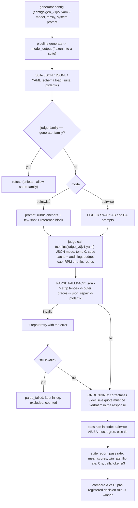

# Problem 2 — LLM-as-Judge Evaluation Pipeline

A test suite (JSON / JSONL / YAML) goes in; structured verdicts and a suite report come out. The pipeline handles malformed JSON, logs every prompt and raw response, compares two configs and declares a winner, and **measures five judge biases, before vs after mitigation**.

Tags: **[MEASURED]** = from our runs; every number in `results/` is regenerated from `cache/calls.jsonl` with `--offline`.

## Architecture



## Setup and run (Windows PowerShell, Python 3.11)

```powershell
cd problem2-llm-judge
..\.venv\Scripts\python -m pip install -r requirements.txt
# repo-root .env: GEMINI_API_KEY_P2 (Problem 2 uses only this key; all variable names: .env.example)
..\.venv\Scripts\python -m judge run --suite suites/demo.yaml                 # suite in -> results/run_demo_judge_v1.{md,json}
..\.venv\Scripts\python -m judge compare --a suites/ab_gen_v1.jsonl --b suites/ab_gen_v2.jsonl
..\.venv\Scripts\python -m judge experiments --offline                      # rebuild every bias/validation/A-B table from the log
..\.venv\Scripts\python -m judge show --pair f1-T-vs-VW                      # raw judge prompt + raw response, both orders
..\.venv\Scripts\python -m pytest -q                                         # offline tests
```

- **Independent configs:** judge and generator are configured separately, `configs/judge_v0.yaml` / `judge_v1.yaml` vs `configs/gen_v1.yaml` / `gen_v2.yaml`. Each has a `model` and a `family`.
- **Models:**
  - judge: `gemini-3.5-flash-lite` (family gemini). It replaced `gemini-3.6-flash`, whose free tier allows only 20 requests/day;
  - generator: `gemma-4-31b-it` (family gemma).
- **Spend cap:** a hard budget cap (`BUDGET_USD=3.5`) is checked before every call.
- **Audit log:** every call is appended to `cache/calls.jsonl` with tag, model version, system prompt, full prompt, raw text, tokens, cost and latency. It is committed, so all results can be audited and replayed.

## Judging design

**Modes:** pointwise and pairwise.

| Mode | When it fits | Used here for |
|---|---|---|
| Pointwise, reference-based | a gold answer exists (facts, math, extraction) | probe suite, A/B pass rates |
| Pointwise, reference-free | open-ended tasks; gating on an absolute bar | supported (e.g. `free-1` in the demo suite) |
| Pairwise A-vs-B | choosing between two configs; small differences; robust to score clustering | position/verbosity probes, A/B win rate |

**Rubric** (`judge/rubric.yaml`): 1–5 with anchors at 1, 3 and 5.

| Criterion | Weight |
|---|---|
| correctness | 0.35 |
| faithfulness | 0.20 |
| completeness | 0.15 |
| instruction-following (content-free length counts against it) | 0.15 |
| tone / safety (incl. endorsing a false premise) | 0.15 |

- **Pass rule, computed in code:** weighted score ≥ 3.5, correctness ≥ 3, tone/safety ≥ 4, **and** the correctness evidence is a verbatim quote from the response.
- **Before vs after:** the "before" judge **v0** uses one 1–10 score, no anchors and a single order. The "after" judge **v1** uses the rubric, few-shot anchors, verified evidence and both orders. Both run on the same model and the same data.

**Malformed JSON:** the fallback chain is `json.loads` → strip code fences → extract the outermost `{...}` → `json_repair` → pydantic validation. If that fails, one repair retry is sent with the error. If the retry also fails, the case is `parse_failed`: it is kept in the log, excluded from aggregates and counted in reports. `tests/test_judge.py` covers 8 malformed fixtures.

## Results

All numbers below are **[MEASURED]**.
- **Models:** judge `gemini-3.1-flash-lite` for both v0 and v1, so before and after use the same model and data.
- **Reports:** [`results/bias_validation.md`](results/bias_validation.md) (bias before → after, validation), [`results/report.md`](results/report.md) (suite report) and [`results/usage.md`](results/usage.md) (calls, tokens, latency, cost). Per-call records are in `results/experiments_raw.json`.
- **Checks:**
  - `tests/test_results.py` verifies counts, unique ids, parse rate, a single judge model, and that the metrics match a recomputation.
  - `python -m judge experiments --stage bias --offline` reproduces the reports byte-for-byte from `cache/`.

**Coverage**

| Run | Calls | Result |
|---|---|---|
| P pointwise | 96 (48 outputs × v0, v1) | complete |
| Q pairwise, AB + BA | 96 (24 pairs × 2 orders × v0, v1) | complete |
| S self-preference | 32 (8 pairs × 2 orders × v0, v1) | complete |
| R test-retest | 32 (16 outputs × 2 reruns) | complete |
| AB prompt v1 vs v2 | 48 (12 pairs × 2 orders + 24 pointwise; 42 made live, 6 identical prompts served from cache) | complete |

0 parse failures and 0 repair retries in 298 judge calls, costing $0.1688 (`results/usage.md`).

**A/B comparison** ([`results/ab_report.md`](results/ab_report.md)): generator `gemma-4-31b-it` for both arms, with 12 inputs; judge v1.

| Config | Pass rate | Mean score (0–1) | Win rate |
|---|---|---|---|
| A: `gen_v1` ("Answer the user's request.") | 0.83 [0.58, 1.00] | 1.00 | 0.42 |
| B: `gen_v2` (constraint-following + fact-check prompt) | 0.92 [0.75, 1.00] | 1.00 | 0.58 [0.50, 0.71] |

- **Pairwise, both orders:** B wins 2 (`m2`, `m4`), A wins 0, ties 10. Order flip rate 0%; sign test p = 0.50.
- **Decision rule (fixed before the run):** B wins only if the lower bound of its win-rate CI is above 0.5. The bound is exactly 0.50, so the declared result is **no statistically decisive winner; v1 (A) retained** (no significant difference). v2 is directionally better (2–0), but 12 inputs are too few to show it.
- **Generator history:** `gemma-4-26b-a4b-it`, the earlier approved generator, returned 503 repeatedly. Its 11 outputs stay in `cache/` for audit only. No A/B result mixes generators.
- **Pointwise:** every one of the 24 answers scored 5/5 on every criterion, so pointwise hits a ceiling here. All 3 pass-rule failures (A `m2`, A `m3`, B `f4`) are **grounding-check failures**: the judge's correctness quote was not verbatim in the answer.
  - `m2`: the judge paraphrased.
  - `m3`: markdown `**Yes**` broke the match.
  - `f4`: the LaTeX `	ext` was read as a tab in the judge's JSON.

  So the pass-rate gap reflects the strict verbatim check on formatted text, not answer quality. One pairwise order (`m3`, AB) had an unverifiable decisive quote and became a tie, as designed.

### Results [MEASURED]

| Bias | v0 → v1 |
|---|---|
| Position | flip rate 0% → 0%; slot-1 win rate 50% → 50%; accuracy vs gold 100% (single order) → 100% (swap-aggregated) |
| Verbosity / length | padded-minus-terse score −0.55 → −0.11. v0 **failed 8 of 12 padded-but-correct answers**; v1 passed 12/12 (`experiments_raw.json`, P records by variant). Padded preferred in pairwise 0% → 0%; verbose-wrong preferred 0% → 0% |
| Self-enhancement | δ 0.00 → 0.00. Every one of the 32 verdicts was a tie: the judge rated each answer and its cross-family paraphrase as equal |
| Sycophancy / style | confident-wrong passed 0% → 0% (false-premise subset 0/4 → 0/4); verbose-wrong passed 0% → 0% |
| Score clustering | normalized entropy 0.63 → 0.76 (v1 uses all 5 levels); AUROC correct vs wrong 1.00 → 1.00 |

**Validation:**
- Gold agreement 100% → 100% (Cohen's κ 1.00 → 1.00, n = 36).
- Pairwise gold agreement 100% → 100%.
- Test-retest: 0% pass/fail flips (16 outputs × 3 runs, temperature 0, score range 0.00).
- Adversarial probes (verbose-but-wrong, terse-but-correct, confident-wrong): not fooled.

**Suite report (v1, 48 probes):** pass rate 0.50 [0.35, 0.65], mean score 0.63 [0.54, 0.72]. Mean per criterion:

| Criterion | Mean (1–5) |
|---|---|
| correctness | 3.00 |
| faithfulness | 3.02 |
| completeness | 4.44 |
| instruction-following | 3.54 |
| tone/safety | 4.48 |

**Cost of the mitigations:** v1 pointwise judging cost 3.2× v0 ($0.0448 vs $0.0139 for 48 calls; 37.8K vs 7.8K prompt tokens).

## Discussion

**How biased was the judge before vs after?**
- On this probe suite the naive v0 judge showed **no measurable** position bias, sycophancy or self-preference. The probes hit a ceiling: v0 already scored 100% gold agreement and a 0% flip rate. So the v1 mitigations could not show a reduction in those biases. The honest reading is "no bias detected at this sensitivity", not "bias removed".
- Two effects were measurable:
  - **Length:** v0 was biased *against* length. It failed 8/12 correct answers that had content-free padding. The v1 rubric keeps correctness separate from instruction-following and passed them (padded-minus-terse −0.55 → −0.11).
  - **Score spread:** v1 spread its scores over the full scale (entropy 0.63 → 0.76) with no loss of separation (AUROC 1.00).
- The same pattern held for the replaced judge `gemini-3.5-flash-lite` (interim, v0 only: [`results/interim_gemini-3.5-flash-lite.md`](results/interim_gemini-3.5-flash-lite.md)).

**Limitations, stated rather than fixed after seeing the data:**
- The probes are clear-cut, so they cannot reveal subtler biases. Harder, borderline probes and human-labelled pairs are the next step.
- n is small: 36 gold outputs, 24 pairs, 8 self-preference pairs.
- The self-preference probe is insensitive: all ties.
- The v1 pass rule does not gate on instruction-following. Padded answers to "answer in exactly one word" items still pass, although their instruction-following score drops.
- Judge and generators all come from one vendor (Google).
- A/B has only 12 inputs. Pointwise judging hits a ceiling, and the verbatim-quote grounding check is brittle on markdown/LaTeX answers. Normalizing formatting before matching is a candidate fix; it is not applied, because the method was fixed before the run.

**Would we let it gate a release?** Not as the only gate (evidence for the decision):
- On clear-cut cases it is accurate, deterministic at temperature 0 and order-insensitive.
- Its real-task reliability is untested.
- The pass rule ignores instruction-following.

Reasonable guardrails:
- use it as a regression filter;
- run pairwise in both orders with verified quotes;
- send every failure and every AB/BA disagreement to human review;
- re-validate against human labels on harder probes before trusting it with borderline releases.

### Reproduce (offline, from committed caches)

```powershell
..\.venv\Scripts\python -m judge experiments --offline   # rebuilds bias_validation.md, report.md, ab_report.md
..\.venv\Scripts\python -m judge usage --offline
..\.venv\Scripts\python -m pytest -q
```
