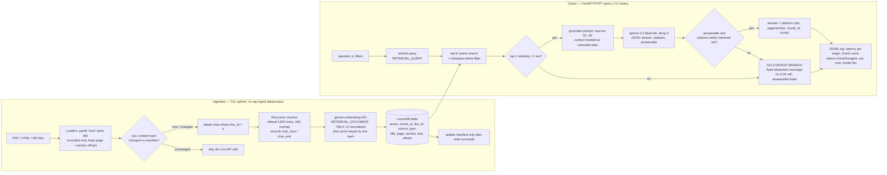
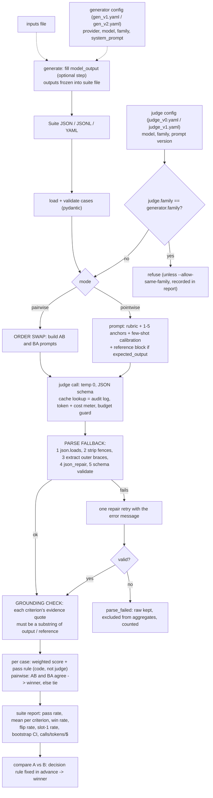

# Architecture & Implementation Plan — Synergy Labs Applied AI/ML Take-Home

*Status: **Revision 2.1**. Revision 2 was approved with the D1–D7 defaults. Phase 0 is complete (see `evidence/phase0_summary.md`).*
*Revision 2.1 (Phase 0 outcome):*
- *The judge is switched from `gemini-3.8-flash` (503 "high demand" on every call) to **`gemini-3.6-flash`** (same price).*
- *The second-family generator is pinned to **`gemma-4-31b-it`**.*
- *The apps live in the pre-existing folders `problem1-rag/` and `problem2-llm-judge/`.*
*Prepared: 2026-11-25 · Sources: `reference/Gen AI_assignment.pdf` (2 pp), `reference/submission_template.docx`*

> **Number policy (applies to the whole repo).** Every number carries one of three tags:
> **[MEASURED]** comes from our own runs, with the results file named next to it.
> **[PROJECTED]** is computed from public prices × stated assumptions (× a measured input where we have one).
> **[ESTIMATE]** is a plan-time guess. These appear **only in this plan** and never in result tables.
> This document contains no [MEASURED] values.

---

## 0. Summary

### 0.1 What changed from Revision 1

| Area | Rev 1 | **Rev 2** | Effect |
|---|---|---|---|
| P2 judge calls | ≈ 1,360 | **≈ 340** (base) / ≈ 250 (cut-line floor) | −75% |
| P2 data | MT-Bench download (100 human pairs) | **in-repo probe suite**: 12 base items × 4 variants built in code, gold labels known by construction. No dataset download | weaker external validity (§14) |
| Bias design | separate experiment per bias | **one probe suite, two judge versions (v0 naive vs v1 mitigated).** Each judge call feeds several bias metrics | all 5 biases still get a before → after |
| RAG eval set | 25 + 8 | **18 eval** (14 answerable + 4 unanswerable) + 5 dev questions (not reported) | inside the 15–20 window |
| P1 answer judging | 2 calls per answer × 3 configs | **1 combined call per answer, main config only.** Chunk sweep is retrieval-only (no LLM) | −85% P1 judge calls |
| Experiments | k, chunk, dim, τ, filter, 1M latency, FAISS, HelpSteer2 | **kept:** k sweep, chunk sweep, latency (real + 100K synthetic), cost model. **Stretch:** dim sweep (no API), 1M latency, FAISS. **Dropped:** HelpSteer2, judge ensemble | fewer artifacts |
| Second model family | Ollama install (≈ 3 GB) | **Gemma via the same Gemini API key** (no install, free tier). Ollama is an optional upgrade | weaker self-enhancement mitigation (§14) |
| Billing | Tier 1 recommended | **free tier by default; no billing enabled by us.** Hard cap `BUDGET_USD=5` in code | runs may need to span quota resets |
| Est. API spend | ≈ $15 | **≈ $1.3 base, ≈ $2.6 with debugging overhead [ESTIMATE]**, paid-tier equivalent; $0 on the free tier | under $5 |

### 0.2 The two apps in one paragraph each

**P1 RAG.** Embedded **LanceDB** (no always-on server), `gemini-embedding-001` at 768-d, `gemini-3.1-flash-lite` as generator, FastAPI `POST /query`. Idempotent ingest uses deterministic IDs and a content-hash manifest. Relevance is judged by **span overlap** with gold quotes, which keeps IR metrics valid across chunk sizes. Abstention uses a similarity gate τ, the model's `answerable` flag, and a citation check. Evaluation covers 18 frozen questions on three layers (retrieval / answer / cost + latency).

**P2 Judge.** Pointwise (reference-based when `expected_output` exists, otherwise reference-free) **and** pairwise with order swap. Anchored 5-criterion rubric. Verdicts are parsed through a 5-step fallback plus one repair retry. An audit log doubles as the replay cache. A **v0 naive vs v1 mitigated** judge runs on one compact probe suite to give before → after for all five biases. Validation uses gold labels known by construction, test-retest, and adversarial probes. The A/B compares generator prompt v1 vs v2 under a decision rule fixed before the run.

---

## 1. Constraints and environment facts (checked 2026-11-25)

**Constraints:** Python 3.11 · Windows · Gemini API · no unnecessary frontend · no fabricated metrics · reproducible · template headings preserved · candidate's reflections not written by us · **estimated API spend < $5 · no purchases or billing changes by us** · 15–20 RAG questions · avoid large downloads · cache everything.

| Fact | Consequence |
|---|---|
| `.venv` = Python **3.11.9** (empty). System `python` = 3.13 | README always calls `.venv\Scripts\python` |
| git 2.47 installed; project **not yet a repo** | `git init` in Phase 0; commit at each milestone (D7) |
| No Docker, no Ollama | Embedded LanceDB; second model family via Gemma on the Gemini API (D2) |
| i5-13450HX (16 threads), 15.7 GB RAM, D: 18 GB free | 100K synthetic latency **[MEASURED]**; 1M is a stretch; **10M is never measured**, its cost is [PROJECTED] only |
| Console cp1252 (the inspection script crashed on `→`) | `PYTHONUTF8=1`; explicit UTF-8 I/O |

**Gemini facts** (aistudio.google.com/docs/{pricing,models,embeddings}, read 2026-11-25; recheck in Phase 0):

| Model ID | Role | $/1M in | $/1M out | Free tier | Notes |
|---|---|---|---|---|---|
| `gemini-embedding-001` | P1 embeddings | 0.15 | — | yes | 3072-d default; MRL `output_dimensionality`; dims below 3072 must be L2-normalized by us; `task_type` RETRIEVAL_DOCUMENT/QUERY; 2,048-token input max |
| `gemini-3.1-flash-lite` | P1 generator; Gemini side of the self-preference probe | 0.25 | 1.50 | yes | stable |
| `gemini-3.6-flash` | Judge (P1 answer eval + P2); replaced `gemini-3.8-flash` after Phase 0 | 0.75 | 3.75 | yes | stable |
| `gemma-4-31b-it` (pinned in Phase 0) | P2 generator (A/B) + other-family side of the probe | free tier only | — | yes | "not available" on the paid tier, so it is free-tier only |
| `gemini-2.5-flash` / `-pro` | **never used** | | | | deprecated; rerouted to other models on **2026-12-01** |

Output prices include thinking tokens. Free-tier traffic "is used to improve Google products". All our data is public, so this is acceptable; the README notes it.

---

## 2. Requirements and scoring map (all mandatory items preserved)

**P = priority:** P0 = must have (scored, or a template cell depends on it) · P1 = should have · S = stretch.

### 2.1 Problem 1 — Cost-Efficient RAG (100 pts)

Areas: **C&I** Correctness & ingestion 20 · **RE** Retrieval eval 20 · **AE** Answer eval 20 · **CA** Cost analysis 20 · **E&C** Engineering & clarity 20.

| ID | Requirement | Area | P | Evidence artifact |
|---|---|---|---|---|
| R1.1 | Ingest PDF / HTML / MD | C&I | P0 | `rag/loaders.py`; corpus has all three types |
| R1.2 | Configurable chunk size + overlap; defaults stated | C&I | P0 | `RAG_CHUNK_SIZE=1200`, `RAG_CHUNK_OVERLAP=200` (chars); README + `/stats` |
| R1.3 | Idempotent re-ingest, no duplicate vectors | C&I | P0 | deterministic IDs + manifest + `merge_insert`; offline pytest; screenshot of the count before and after |
| R1.4 | Record embedding model + dimensionality | C&I | P0 | table metadata, manifest, `/stats`, every results file |
| R1.5 | Vectors + metadata; ≥1 metadata filter | C&I | P0 | `source_type`, `doc_id`, `title`, `page`, `section`; `filters` param |
| R1.6 | Top-k, k is a parameter | C&I | P0 | API/CLI `k`; eval at k ∈ {1,3,5,10} |
| R1.7 | Grounded answer citing the chunks used | C&I, AE | P0 | JSON `{answer, citations, answerable}`; citations checked against the retrieved set |
| R1.8 | No-relevant-context handling without hallucinating | C&I, AE | P0 | τ gate + `answerable` flag + zero-valid-citations → abstain; abstention metrics |
| R1.9 | HTTP endpoint (preferred) or CLI | C&I | P0 | FastAPI `POST /query` + CLI `query` |
| R1.10 | Config via env, no hardcoded secrets | E&C | P0 | `.env.example` (names only); `.env` gitignored |
| R1.11 | Log per-query latency, chunk count, token usage | E&C | P0 | JSONL log; screenshot 1.5 |
| R1.12 | Store choice justified (2nd store = bonus) | E&C | P0 / S | §10.1 table; FAISS benchmark is stretch |
| E1.1 | Fixed 15–30 questions (**user constraint: 15–20**) | RE | P0 | **18** in `eval/questions.jsonl`, frozen before tuning |
| E1.2 | Recall@k/Hit, MRR, nDCG@k, context precision | RE | P0 | `ir_metrics.py` + hand-computed tests |
| E1.3 | Faithfulness + answer relevance | AE | P0 | one combined judge call per answer; quotes checked in code |
| E1.4 | EM/F1 with gold answers | AE | P0 | short gold answers; SQuAD normalization |
| E1.5 | Monthly cost 100K / 1M / 10M vs managed, assumptions stated | CA | P0 | `cost_model.py` + `pricing.yaml` → table tagged [PROJECTED] |
| E1.6 | p50/p95 retrieval latency; trade-offs named | CA | P0 | `latency_bench.py` → [MEASURED] |
| D1 | Service · harness + results (3 layers) · cost table · README Discussion | E&C | P0 | `results/` + README |

### 2.2 Problem 2 — LLM-as-Judge (100 pts)

Areas: **PC** Pipeline correctness 20 · **JD** Judging design 20 · **BH** Bias handling 25 · **JV** Judge validation 20 · **C&E** Comparison & engineering 15.

| ID | Requirement | Area | P | Evidence artifact |
|---|---|---|---|---|
| R2.1 | Suite JSON/YAML `{input, system_prompt, model_output, expected_output?, criteria?}` | PC | P0 | pydantic schema; `.json/.jsonl/.yaml` loaders; tests |
| R2.2 | Structured verdict (per-criterion score + rationale + overall), robust to malformed JSON | PC | P0 | JSON-schema mode + 5-step fallback + 1 repair retry; 8 malformed fixtures; live `parse_failed` count |
| R2.3 | Explicit rubric | JD | P0 | `rubric.yaml` (§4.3) |
| R2.4 | ≥1 mode, explain when each fits | JD | P0 | pointwise (ref-based / ref-free) + pairwise; README table |
| R2.5 | Suite report: pass rate, mean scores, win rate | PC, C&E | P0 | `report.{json,md}` |
| R2.6 | Compare TWO configs, declare a winner | C&E | P0 | `compare`; decision rule fixed in advance (§5.2) |
| R2.7 | Log every prompt + raw response; replayable | PC | P0 | `runs/*/calls.jsonl` = cache; `replay --offline` |
| R2.8 | Track judge tokens / calls | C&E | P0 | usage incl. thoughts → calls/tokens/$ per report [MEASURED] |
| R2.9 | Judge and generator configured independently | C&E | P0 | `configs/judge_*.yaml`, `configs/gen_*.yaml`, each with `family` |
| B1–B5 | Position · verbosity · self-enhancement · sycophancy · clustering: named, mitigated in code, measured | BH | P0 | §5.2 bias matrix, v0 → v1 |
| V1 | Validation ≥1 of: gold/human agreement, test-retest, adversarial | JV | P0 | **all three**, against gold labels known by construction |
| D2 | Pipeline · rubric doc · position-bias results · validation artifact · A/B winner · README Discussion | all | P0 | `results/{report,bias_report,validation,ab_report}.md` |

### 2.3 Template-driven requirements (`submission_template.docx`)

| ID | Template requirement | Consequence |
|---|---|---|
| T1 | Headers must not be deleted or renamed | fill a copy; `check_template_headings.py` asserts the heading list is identical |
| T2 | Unexplained number scores zero | the tag policy (top of file) + generated tables + provenance in every results file |
| T3 | "N/A" needs a one-line reason | e.g., EM if not meaningful |
| T4 | Reflections written without AI | left blank for the candidate (§15) |
| T5 | Diagrams show the no-context branch / order swap / parse fallback | §3.1, §4.1 Mermaid → PNG |
| T6 | 1.4 "what degraded at other settings?" | **chunk sweep stays P0** (retrieval-only, embedding cost only) |
| T7 | 1.4 embedding cost/quality trade-off | dim sweep = stretch (no API: truncate cached 3072-d) |
| T8 | 1.3.4 latency conditions | bench prints k, rows, index, CPU/RAM, OS, versions |
| T9 / T13 | Screenshots: query log; re-ingest count; raw prompt + response; same pair in both orders + flip rate; adversarial verdict | screenshot-ready CLI output (`query`, `ingest`, `show`); checklist in `reports/screenshot_checklist.md` |
| T10 | 2.3.2 before → after for all 5 biases | v0 vs v1 design (§5.2) |
| T11 | 2.3.3 rows: agreement %, κ, test-retest (temperature), adversarial | all four filled from §5.2 runs |
| T12 | 2.3.4 pass rate + mean score + win rate per config | A/B runs pointwise **and** pairwise |
| T14 | Clone and run in ~10 min | one install per app; `--offline` replay with committed caches, no API key needed |

---

## 3. Problem 1 architecture — Cost-Efficient RAG

### 3.1 Flow



### 3.2 Components

| Component | Responsibility | Key choice |
|---|---|---|
| `loaders.py` | PDF (pypdf, per page), HTML (bs4; drop script/style/nav/footer), MD (`#` → section) | Normalized per-document text + offset maps. Chunks and gold quotes share one coordinate system |
| `chunking.py` | paragraph → sentence → word recursive split; size and overlap in characters | ~40 lines of our own code, no LangChain, because exact `char_start/char_end` are needed for span labels |
| `embeddings.py` | batched embed, backoff, disk cache keyed by `(model, dim, task, sha256(text))` | Embed once at 3072-d, derive 768-d by truncating and renormalizing (Phase 0 checks this against the API's 768-d output). The cache makes re-ingest and re-eval free |
| `store.py` | create/open, delete-by-doc, `merge_insert(chunk_id)`, search + `where`, count | One table per `(model, dim, chunk cfg)`. Filters built only from allow-listed fields with escaped values |
| `ingest.py` | manifest, skip unchanged, `--prune` deleted files | `doc_id = sha256(relpath)`; `chunk_id = sha256(doc_id ∣ cfg ∣ char_start ∣ sha256(text))`. The manifest is written only after the store write succeeds, so a crash self-heals on the next run |
| `answer.py` | retrieve → gate → prompt → JSON → validate citations → abstain/return | Citations outside the retrieved set are dropped. "Answerable" with zero valid citations → abstain. Context is delimited and marked untrusted (the corpus contains real injection examples) |
| `llm.py` | google-genai wrapper: pinned IDs, temp 0, `seed`, minimal thinking, usage capture, **response cache**, budget guard, RPM throttle | duplicated in P2 (~80 lines) so the apps stay independent |
| `api.py` / `cli.py` | `POST /query`, `GET /stats`, `GET /health`; CLI `ingest/query/eval/bench/cost/stats` | FastAPI `/docs` is the only UI |

`POST /query` returns `answer, abstained, citations[{sid, chunk_id, doc, page|section, score}], retrieved, latency_ms{embed, retrieve, generate, total}, tokens{prompt, output, thoughts}, est_cost_usd, models`.

**Env vars (names only):** `GEMINI_API_KEY, RAG_DB_PATH, RAG_EMBED_MODEL, RAG_EMBED_DIM, RAG_CHUNK_SIZE, RAG_CHUNK_OVERLAP, RAG_TOP_K, RAG_MIN_SIMILARITY, RAG_GEN_MODEL, RAG_JUDGE_MODEL, RAG_LOG_PATH, BUDGET_USD, LLM_RPM`.

---

## 4. Problem 2 architecture — LLM-as-Judge

### 4.1 Flow



### 4.2 Data contracts

```yaml
- id: fact-03-T                   # case = one model output to judge
  input: "..."
  system_prompt: "You are a concise assistant. Answer in at most 2 sentences."
  model_output: "..."
  expected_output: "..."          # optional → reference-based mode
  criteria: [correctness, instruction_following]   # optional subset of rubric
  meta: {variant: T, gold: pass, generator: hand-written, family: none}
# pairwise: two suites with the same ids joined on id, or inline output_a / output_b (+ gold_winner for probes)
```

Verdict v1 (pointwise): `{"criteria": {"<name>": {"score": 1-5, "evidence": "<verbatim quote>", "rationale": "..."}}, "overall_rationale": "..."}`. The overall score and pass/fail are **computed in code**. Pairwise: `{"winner": "A|B|tie", "per_criterion": {...}, "rationale": "..."}`.

### 4.3 Rubric (fixed before any run)

| Criterion | Definition | Anchors (1 / 3 / 5) | Weight |
|---|---|---|---|
| Correctness | facts and conclusions right; uses the reference when given | central claim wrong / minor error / fully correct | 0.35 |
| Faithfulness | no unsupported or invented specifics | fabricated / one unsupported detail / every claim supported | 0.20 |
| Completeness | every part of the ask covered | misses main ask / partial / all parts | 0.15 |
| Instruction-following | obeys system prompt + input constraints. **Unsupported length that adds no requested content is penalized here** | ignores / minor deviation / full | 0.15 |
| Tone / safety | appropriate register, nothing harmful | unsafe / awkward / appropriate | 0.15 |

**Pass rule:** weighted ≥ 3.5 **and** correctness ≥ 3 **and** tone/safety ≥ 4.

**Judge v0 ("before"):** one overall 1–10 score + short rationale. No anchors, no evidence quotes, no length clause. It still uses JSON and the same parser.

### 4.4 Modes: when each fits (also in the README)

| Mode | Fits when | Weakness | Used here for |
|---|---|---|---|
| Pointwise reference-based | a gold answer exists | needs references | probes, A/B pass rates |
| Pointwise reference-free | open-ended tasks, absolute gating | clustering, drift | supported, demo case |
| Pairwise | choosing between configs | position bias; no absolute bar | position/verbosity probes, A/B win rate |

---

## 5. Compact evaluation design

### 5.1 Problem 1

**Corpus (D1), about 8 files, < 10 MB, ≈ 100–150K tokens [ESTIMATE]:** NIST AI RMF 1.0 (PDF), NIST AI 600-1 GenAI Profile (PDF), 4 OWASP Top-10-for-LLM risk pages (MD, CC BY-SA 4.0), 2 Wikipedia articles (HTML, CC BY-SA 4.0). `SOURCES.md` records URL, license and date.

**Questions: 18 eval** (frozen and committed before any tuning; Claude drafts, **candidate reviews for ~15 min**):

| Type | n | Purpose |
|---|---|---|
| single-fact | 6 | baseline retrieval |
| paraphrased (low word overlap) | 3 | prevents easy wins from shared wording |
| multi-span (2 evidence spans) | 3 | recall vs hit rate differ |
| filter-scoped | 2 | metadata filter works |
| unanswerable, plausible, near-domain | 4 | abstention |

Plus **5 dev questions** (3 answerable + 2 unanswerable), used only to choose τ and debug prompts. Never reported. `validate_questions.py` fails if any gold quote is not found in its document's normalized text.

**Relevance:** chunk *c* is relevant to gold span *E* when they are in the same document and `overlap(c, E) / len(E) ≥ 0.5`. Labels are therefore independent of chunk boundaries, which makes the chunk sweep fair.

| Layer | Metric | Definition | Tag |
|---|---|---|---|
| Retrieval | Hit@k, Recall@k (evidence level), MRR@k, nDCG@k (binary gain; IDCG uses **all** relevant chunks in the index), Precision@k + AP@k as context precision | macro over 14 answerable; 95% bootstrap CI (seed 42) | [MEASURED] |
| Answer | Faithfulness = supported claims / claims (claim quotes checked in code); relevance 1–5 → (s − 1)/4 | **one combined judge call per answered question** | [MEASURED] |
| Answer | EM, token-F1 (SQuAD); citation precision (no LLM); correct-abstain on 4 unanswerable; false-abstain on 14 answerable | — | [MEASURED] |
| Latency | retrieval p50/p95/p99 (search only); query-embed latency separately; end-to-end p95 from the eval run's logs | conditions block | [MEASURED] |
| Cost | monthly $ at 100K / 1M / 10M vs managed | §8 | [PROJECTED] |

| # | Experiment | P | API cost |
|---|---|---|---|
| X1 | k ∈ {1, 3, 5, 10} retrieval metrics (primary k = 5) | P0 | none (cached vectors) |
| X2 | chunk sweep (600/100, 1200/200, 2400/400): retrieval metrics + context tokens per query, **no generation** | P0 | corpus embedding × 3 |
| X6 | latency on the real corpus: 20 warm-ups + 18 × 20 repeats | P0 | none |
| X7 | latency on 100K seeded random 768-d vectors, flat vs IVF-PQ, ANN recall@10 vs exact (random data is pessimistic for ANN; stated) | P0 | none |
| X8 | end-to-end p95 from the main eval run | P0 | included |
| X3 | dim sweep 256/768/1536/3072 by truncating cached 3072-d | S | none |
| X7b | 1M synthetic | S | none |
| X10 | FAISS second-store benchmark | S | none |

### 5.2 Problem 2: one probe suite, two judge versions

**Base items (in-repo, no download):** 12 short tasks, each with `input`, `system_prompt`, `expected_output`: 4 factual, 4 reasoning/math, 4 constrained-instruction (format/length rules). Claude drafts them; the candidate reviews (~15 min).

**Variants per item, built by `build_probes.py` (deterministic, committed):**

| Variant | Construction | Gold |
|---|---|---|
| **T** terse-correct | hand-written minimal correct answer | pass |
| **P** padded-correct | T + deterministic filler template (restates the question, generic hedges, no new facts), ≈ 3× length | pass; should **not** beat T |
| **VW** verbose-wrong | long, fluent, one wrong key fact | fail |
| **CW** confident-wrong | short wrong answer in an authoritative tone. In 4 items the input has a false user premise that the output agrees with | fail |

That gives 48 outputs with gold labels known by construction.

**Runs (cache keys include the judge version and rerun index):**

| Run | What | Judge calls |
|---|---|---|
| **P** | pointwise on all 48 outputs × {v0, v1} | 96 |
| **Q** | pairwise on 24 pairs (12 T-vs-VW + 12 T-vs-P) × AB/BA × {v0, v1} | 96 |
| **S** | self-preference: 6 items. Set X = Gemini answer vs Gemma paraphrase of it; set Y = Gemma answer vs Gemini paraphrase of it. AB/BA × {v0, v1} | 48 (+24 generation) |
| **R** | test-retest: v1 pointwise on 16 outputs (4 items × 4 variants) × 2 extra reruns at temperature 0, cache bypassed | 32 |
| **AB** | 15 inputs (12 base + 3 constrained). Gemma generator with prompt v1 vs v2. v1 judge: pairwise AB/BA (30) + pointwise on both arms (30) | 60 (+30 generation) |

**Bias matrix: each row fills one line of template 2.3.2.**

| Bias | Mitigation in code (v1) | Metric (before = v0 → after = v1) | Data |
|---|---|---|---|
| Position | AB + BA on every pair; final verdict = agreement, otherwise tie | flip rate; slot-1 win rate (ideal 50%); accuracy vs gold for a single-order verdict (v0) vs the swap-aggregated verdict (v1); share of verdicts turned into ties | Q |
| Verbosity / length | rubric length-penalty clause; padded probe | mean normalized Δscore (P − T); P(P preferred over T); P(VW preferred over T); VW pass rate | P, Q |
| Self-enhancement | `family` guard refuses same-family judge/generator; A/B generator is Gemma, judge is Gemini | δ = ½[P_X(original wins) − P_Y(original wins)], which cancels the advantage originals get from paraphrase quality | S |
| Sycophancy / style | per-criterion evidence quotes checked as substrings (unverifiable → ungrounded); reference block | fooled rate = CW and VW judged pass (false-premise subset reported separately) | P |
| Score clustering | 1–5 anchors + 3 few-shot calibration examples; pairwise for comparisons | normalized entropy, distinct levels used, **AUROC (correct vs wrong scores)**, which does not depend on the scale, so v0's 1–10 and v1's 1–5 compare fairly | P |

**Validation (template 2.3.3), all from the runs above:**

| Method | Metric | Data |
|---|---|---|
| Agreement with gold labels | accuracy + Cohen's κ (pass/fail; pairwise winner), v0 vs v1 | P, Q |
| Test-retest | verdict flip rate + mean \|Δscore\| across 3 runs at temperature 0 | R |
| Adversarial | fooled Y/N + rate: VW passed? T failed? (the assignment's verbose-but-wrong / terse-but-correct) | P, Q |

**A/B decision rule (written in `ab_report.md` before the run):** win rate(v2) = (wins + 0.5 · ties) / 15 over swap-consistent verdicts; 95% bootstrap CI over cases + exact sign test. Declare **v2** if the CI lower bound > 0.5, **v1** if the upper bound < 0.5. Otherwise "no significant difference → keep v1 (incumbent)", which is still a declared decision. Report pass rate, mean score, win rate, calls, tokens and $ per config. Prompt v2 adds explicit constraint-following and self-checking, so a real difference is plausible. The rule decides; we do.

**Malformed-JSON robustness:** 8 fixture tests (fenced, trailing comma, single quotes, truncated, extra prose, missing criterion, "4/5" string, out-of-range). The live `parse_failed` rate is reported from every run. No extra API calls.

---

## 6. Measurement policy, caching and reproducibility

| Tag | Source | Examples | Where it appears |
|---|---|---|---|
| **[MEASURED]** | our runs; the results JSON has `"kind": "measured"` + provenance | IR and answer metrics, latency, bias and validation metrics, **actual tokens and $ from `usage_metadata`** | results tables, README, docx |
| **[PROJECTED]** | `cost_model.py`: price (URL + date) × assumptions × measured bytes per vector | monthly store cost at 100K / 1M / 10M | cost table (column header says so) |
| **[ESTIMATE]** | plan-time | API budget, hours | this plan only |

**Caching (no repeat spending):**
- **LLM cache = audit log.** Each call is stored as `{key, prompt, raw_response, usage, latency, ts}`, with `key = sha256(provider, model, params, prompt_template_version, prompt, rerun_idx)`. Every call checks it first. A test asserts that a cache hit makes no network call.
- **Embedding cache** is keyed by `(model, dim, task, sha256(text))`. The 768-d cache for all chunk configs + queries (≈ 6 MB [ESTIMATE]) is committed.
- The client honours `LLM_RPM` (throttle) and `BUDGET_USD` (aborts before the next call would exceed it). Runs are **resumable**: an interrupted run continues from cache, so hitting a quota costs nothing extra.
- **Spend reporting:** "actual spend" sums usage over non-cached calls only [MEASURED]; replay costs $0.

**Reproducibility:** exact pinned packages and model IDs; seeds everywhere (bootstrap, synthetic vectors, Gemini `seed`); temperature 0; frozen data with hashes in each results file (plus git SHA, config, SDK version, timestamp). `python -m rag eval --offline` and `python -m judge reproduce --offline` rebuild every table from committed caches **with no API key** and identical output. Live reruns can differ, and test-retest (run R) measures by how much.

---

## 7. Revised API call budget [ESTIMATE]

Token assumptions per call: judge v1 ≈ 1,600 in / 700 out (incl. minimal thinking); judge v0 ≈ 500 in / 400 out; generator ≈ 400 in / 400 out; P1 answer judge ≈ 2,500 in / 700 out; P1 generation ≈ 2,000 in / 300 out. Actual usage is logged and reported as [MEASURED].

| App | Run | Model | Calls | Est. $ (paid-tier equivalent) |
|---|---|---|---|---|
| P1 | corpus embedding × 3 chunk configs (≈ 0.4M tokens, batched) | embedding-001 | ≈ 20 requests | 0.06 |
| P1 | query embeddings (18 + 5) | embedding-001 | 1–2 | ~0 |
| P1 | generation: main eval 18 + dev 5 | 3.1-flash-lite | 23 | 0.02 |
| P1 | answer judge, 1 per answered question | 3.6-flash | ≤ 18 | 0.08 |
| P1 | live smoke / screenshots | flash-lite | ~10 | 0.01 |
| P2 | P (48 × v0/v1) | 3.6-flash | 96 | 0.27 |
| P2 | Q (24 pairs × 2 orders × v0/v1) | 3.6-flash | 96 | 0.31 |
| P2 | S (judge) + 24 generation | 3.6-flash + flash-lite / Gemma | 48 + 24 | 0.17 |
| P2 | R (16 × 2 reruns) | 3.6-flash | 32 | 0.12 |
| P2 | AB judge + 30 generation | 3.6-flash + Gemma | 60 + 30 | 0.25 |
| P2 | repair retries (~3%) | 3.6-flash | ~10 | 0.04 |
| | **Base total** | | **≈ 470 requests: ≈ 360 judge calls + ≈ 87 generation calls + ≈ 22 embedding requests** | **≈ $1.3** |
| | + 100% debugging overhead (prompt edits invalidate the cache) | | | **≈ $2.6** |
| | worst case: output tokens 2× assumed **and** 100% overhead | | | ≈ $4.4 |
| | **Hard cap in code** | | | **$5.00** |

- **Free tier:** actual spend should be $0. The constraint is daily quota: about 360 judge calls on `gemini-3.6-flash`. Phase 0 records the real RPM/RPD from AI Studio. If quota blocks a run, the run pauses (cached work is kept) and **you decide** (§16 D3). We never enable billing.
- **Cut-line floor (≈ 250 judge calls):** R → 1 rerun (16); Q → 16 pairs (64); S → 4 items (32). Every bias row and validation row survives, with smaller n.

---

## 8. Vector-store cost analysis (output is [PROJECTED]; inputs are measured where possible)

**Sizing arithmetic:** float32 at 768-d = 3,072 B/vector, so raw vectors are 0.31 GB at 100K, 3.07 GB at 1M and 30.7 GB at 10M. Text and metadata bytes per chunk and index overhead are **[MEASURED]** on our table and the 100K synthetic table, then scaled.

| Scenario | Costed items | Price source (URL + date in `pricing.yaml`) |
|---|---|---|
| Self-hosted A: LanceDB on 1 VM + SSD, snapshots to object storage | VM sized from measured RAM/disk need + disk $/GB-mo + backup storage | one cloud provider, one region, stated |
| Self-hosted B: LanceDB on object storage + scale-to-zero compute | storage + per-query compute. **Latency not measured**; stated as an accepted trade-off | same |
| Managed: Pinecone Standard serverless | $50/mo min; storage $0.33/GB-mo; writes $4–4.50/M WU; reads $16–18/M RU (read 2026-11-25; RU-per-query rule to confirm in Pinecone docs) | pinecone.io/pricing |
| Managed, always-on: Pinecone Dedicated Read Nodes | hourly node price (the always-on analogue of "pods" in the brief) | to fetch |

Query volume: baseline 50K/month (lightly queried), with sensitivity rows at 10K / 1M / 10M per month to show the **crossover** that answers "when would you switch back to managed". One-time ingest is a separate row. Excluded, and stated: on-call/engineering time, egress. HA is shown as a ×2 variant.

---

## 9. Repository layout (two independent apps, no cross-imports)

```
SynergyLabs-GenAI-Assignment/
├─ README.md  .gitignore
├─ reference/                         # given
├─ reports/ architecture_plan.md  submission.docx  check_template_headings.py  screenshot_checklist.md
├─ problem1-rag/
│  ├─ README.md  requirements.txt  .env.example
│  ├─ rag/  config.py loaders.py chunking.py embeddings.py store.py ingest.py llm.py answer.py api.py cli.py __main__.py
│  ├─ eval/ questions.jsonl dev_questions.jsonl validate_questions.py ir_metrics.py answer_metrics.py
│  │        run_eval.py latency_bench.py cost_model.py pricing.yaml
│  ├─ data/corpus/{pdf,html,md}/ SOURCES.md
│  ├─ cache/  llm.jsonl  emb_768.npz            # committed → offline reproduce
│  ├─ results/                                  # generated, committed
│  └─ tests/
└─ problem2-llm-judge/
   ├─ README.md  requirements.txt  .env.example
   ├─ judge/ config.py schema.py rubric.yaml anchors.yaml prompts/ llm.py parse.py judge.py
   │         aggregate.py bias.py validate.py stats.py generate.py build_probes.py cli.py __main__.py
   ├─ configs/ judge_v0.yaml judge_v1.yaml gen_v1.yaml gen_v2.yaml
   ├─ suites/ base_items.yaml probes.jsonl demo.yaml ab_inputs.yaml selfpref.jsonl
   ├─ runs/<run_id>/calls.jsonl                 # committed audit log = cache
   ├─ results/ report.md bias_report.md validation.md ab_report.md
   └─ tests/
```

---

## 10. Technology stack

### 10.1 Vector store: **LanceDB**

| Store | Setup here | Filter | Idempotent upsert | 10M cost profile | Verdict |
|---|---|---|---|---|---|
| **LanceDB** | pip, embedded | SQL-like `where` | `merge_insert` | disk-based IVF-PQ; local SSD or object storage; no always-on server | **chosen** |
| Qdrant | local mode is meant for testing; the server needs Docker (absent) | strong | upsert by ID | strong, but an always-on server | runner-up |
| pgvector | Postgres install needed | SQL | `ON CONFLICT` | HNSW is RAM-heavy | good if Postgres already exists |
| ChromaDB | pip, heavier dependency tree | `where` | upsert | in-memory HNSW | prototypes |
| FAISS | pip | none | DIY | fast, no persistence or metadata | stretch benchmark only |
| sqlite-vec | pip, pre-1.0 | columns | `INSERT OR REPLACE` | brute-force scan (verify) | too risky at 10M |

Trade-offs we accept: one writer at a time; no built-in auth or replication in the open-source version (snapshots to object storage instead); fewer ops tools; on-call time is not costed.

### 10.2 Libraries (exact versions pinned with `pip freeze` at install)

| App | Packages | Not used, and why |
|---|---|---|
| both | `google-genai`, `python-dotenv`, `numpy`, `pytest` | `scipy`/`sklearn`: κ, AUROC, Spearman, bootstrap and the sign test are a few tested lines each |
| P1 | `lancedb`, `pypdf`, `beautifulsoup4`, `fastapi`, `uvicorn`, `httpx` (TestClient) | LangChain/LlamaIndex/RAGAS: framework weight and API churn for a 5-step pipeline. `pymupdf`: AGPL license |
| P2 | `pydantic`, `pyyaml`, `json-repair` | `datasets`/`huggingface_hub`: no download in base scope |

---

## 11. Tests, screenshots and reports (all offline; tests use fake embedders and LLMs)

| App | Automated tests (P0) |
|---|---|
| P1 | chunk offsets, sizes and overlap · **ingest twice → same count; edit one doc → only its rows change** · filter allow-list and escaping · IR metrics vs hand-computed values (incl. the IDCG trap) · citations outside the retrieved set dropped; zero-citation → abstain · API contract via TestClient · `validate_questions` |
| P2 | 8 malformed-JSON fixtures · JSON and YAML suite loading · pass rule · win rate with ties · swap-consistency logic · κ / AUROC / bootstrap determinism / sign test · cache hit → no network · family guard · probe builder is deterministic |

**Screenshots for the template (the candidate captures them; the commands are in `reports/screenshot_checklist.md`):**
1. `python -m rag query "..."`, showing latency per stage, chunk count and tokens.
2. `python -m rag ingest data/corpus` run twice, with the vector count unchanged.
3. `python -m judge show <call_id>`, showing a raw prompt + raw response from the log.
4. `python -m judge show --pair <id>`, showing AB and BA verdicts + flip rate.
5. Adversarial verdict (VW / T) from `show`.

**Generated reports:** `problem1-rag/results/{eval_report.md, chunk_sweep.md, latency.md, cost_table.md, eval_results.json}` · `problem2-llm-judge/results/{report.md, bias_report.md, validation.md, ab_report.md}`. Every table carries its tag and provenance.

---

## 12. Technical risks

| # | Risk | L / I | Mitigation |
|---|---|---|---|
| 1 | Model churn (2.5 reroute on 2026-12-01; 3.x/4.x thinking parameters unverified) | H / H | Phase 0 smoke test; pinned IDs; model ID recorded per result |
| 2 | **Free-tier quota stalls P2 runs** | H / M | throttle, resumable cache, cut-line floor; pause and ask (D3) |
| 3 | Gemma unavailable or unusable for this key | M / M | Phase 0 check. Fallbacks: Ollama (D2-b) or same-family run with `--allow-same-family`, flagged in the report |
| 4 | Small n → wide CIs; v0 → v1 differences may not be significant | H / M | report counts + CIs, never bare %; avoid overclaiming |
| 5 | Probes too easy → gold agreement overstates reliability | M / H | VW and CW crafted to be plausible; candidate review; stated in §14 |
| 6 | JSON-schema mode hides the fallback path | M / L | fixture tests; live parse-failure count reported |
| 7 | LLM-drafted questions copy document wording | M / H | 3 paraphrased questions; candidate review; metrics by type |
| 8 | Leakage when choosing τ | M / M | separate 5 dev questions |
| 9 | Metric bugs (IDCG, κ, AUROC) | M / H | hand-computed tests |
| 10 | PDF extraction noise | M / M | text-based PDFs; quote validator |
| 11 | LanceDB quirks on Windows (`merge_insert`, IVF-PQ needs enough rows) | M / M | pinned version; flat search on the small corpus; IVF-PQ only at 100K |
| 12 | Laptop latency ≠ production | H / M | conditions block; 10M never presented as measured |
| 13 | Cost-model credibility | M / H | sourced, dated prices; HA variant; query-volume sensitivity |
| 14 | Prompt injection from the corpus | M / M | delimiters, instruction hierarchy, citation validation |
| 15 | Secrets leak | L / H | `.env` gitignored; logs never record client config; grep before each commit |
| 16 | Windows encoding/paths | H / L | `PYTHONUTF8=1`, `pathlib`, PowerShell-tested README |

---

## 13. Revised one-day timeline (≈ 9.5 h + 0.5 h buffer)

| Clock | Phase | Built | Tests green at exit | Evidence / report | Commit |
|---|---|---|---|---|---|
| 0:00–0:30 | **0 · Setup** | scaffold, `.gitignore`, deps pinned, `.env.example`; smoke test (model IDs, Gemma ID, 768 vs truncated 3072, JSON schema, usage + thoughts fields, thinking parameter, seed); **record quotas** | — | `reports/phase0_smoke.md` | ✔ |
| 0:30–1:15 | **1a · P1 data** | 8 docs + SOURCES.md; 18 + 5 questions; validator → **candidate review → freeze** | validate_questions | — | ✔ |
| 1:15–2:00 | **1b · Ingestion** | loaders, chunker, embedding cache, store, manifest | chunking, idempotency | screenshot 2 | ✔ |
| 2:00–3:00 | **1c · Query + API** | retrieval + filter, τ (dev set), grounded JSON, citation check, FastAPI, CLI, JSONL log | filters, citations, API | screenshot 1 | ✔ |
| 3:00–4:15 | **2 · P1 eval** | IR metrics, combined answer judge, X1, X2, X6, X7 (100K), X8, cost model | ir_metrics | `problem1-rag/results/*` | ✔ |
| 4:15–6:00 | **3 · P2 core** | schema/loaders, rubric, prompts v0/v1 + anchors, client (cache, throttle, budget), parser, pointwise + pairwise swap, aggregate/report/compare, `replay`, `show` | parser fixtures, stats, aggregate, cache, guard | demo suite → report | ✔ |
| 6:00–6:45 | **4a · P2 data** | 12 base items + probe builder; 15 A/B inputs; Gemma generation v1/v2; self-preference generation → **candidate review** | probe determinism | — | ✔ |
| 6:45–8:00 | **4b · P2 runs** | P, Q, S, R, AB (throttled, resumable) → bias, validation, A/B reports | — | screenshots 3–5 | ✔ |
| 8:00–9:30 | **5 · Package** | READMEs + Discussion drafts (from results); **fresh-clone `--offline` reproduce**; full pytest; fill `submission.docx` (non-reflection cells) + heading check | **all** | docx draft | ✔ final |
| 9:30–10:00 | buffer | quota or latency slippage; stretch items only if green | | | |

P1 (Phases 1–2) and P2 (Phases 3–4) share no code. After Phase 0 they could run in parallel to shorten the day.

**Cut order if behind:** stretch items → P2 cut-line floor (§7) → X7 at 100K becomes 50K → README Discussion trimmed to the required two questions per app. Nothing mandatory is cut.

---

## 14. Requirements that become weaker under the reduced scope

No mandatory requirement is dropped. These become **weaker**, and the README states each one:

| # | Requirement | What weakens | Why it is still defensible / disclosure |
|---|---|---|---|
| W1 | Judge validation: agreement (JV, 20 pts) | **Gold labels come from constructed probes, not human preferences.** Clear-cut right/wrong cases are easier than real quality judgments, so agreement probably **overstates** reliability on open-ended tasks | The brief allows "human/gold labels". Test-retest + adversarial still apply. Optional upgrade: 30 MT-Bench human pairs via the HF datasets-server row API (< 1 MB, ≈ 90 calls, ≈ $0.35 [ESTIMATE]), only with your approval |
| W2 | Self-enhancement (BH) | Gemma is a **different model family but the same vendor** (shared lineage). δ comes from only **6 items** → directional, wide CI | The structural guard is real. Ollama (D2-b) gives true cross-vendor evidence for a ~3 GB download |
| W3 | Bias before → after (BH, 25 pts) | n = 48 outputs / 24 pairs → some v0 → v1 changes may not be statistically significant | Counts and CIs reported; no "fixed" claims without the numbers |
| W4 | A/B winner (C&E) | 15 cases → the rule may end in "no significant difference, keep incumbent" | Still a declared, rule-based decision |
| W5 | Retrieval metrics (RE) | 14 answerable questions → each one moves Hit Rate by ~7 pts; wide CIs | Within the brief's 15–30 window overall; CIs shown |
| W6 | Answer eval (AE) | faithfulness + relevance in **one** judge call (possible cross-influence); judge and generator are both Gemini | non-LLM checks (citation precision, EM/F1) alongside; disclosed |
| W7 | "What degraded at other settings" (template 1.4) | chunk sweep measures **retrieval only**, not answer quality per setting | retrieval + context-token cost is enough to explain degradation; stated |
| W8 | Latency at scale (CA) | measured only up to 100K (1M is stretch); 10M is projection only | the cost table separates [MEASURED] from [PROJECTED] |
| W9 | Test-retest (JV) | 16 outputs × 3 runs | enough to detect gross instability, not small drift |
| W10 | Second-store bonus | dropped to stretch | bonus only, no mandatory loss |

---

## 15. Submission template mapping (headings preserved verbatim)

| Template section | Source | Writer |
|---|---|---|
| Candidate details | — | **candidate** (we fill only "vector store chosen" and "judge / generator families") |
| 1.1 / 2.1 diagrams | §3.1 / §4.1 → PNG | Claude; candidate checks |
| 1.2 / 2.2 setup | READMEs (PowerShell-tested) | Claude |
| 1.3.x / 2.3.x tables | `results/*.md` only, with tags | Claude (pasted numbers) |
| 1.4 / 2.4 design decisions | this plan + results | Claude drafts, candidate edits. **2.4 "gate a release?": Claude gives evidence bullets; candidate writes the verdict** |
| 1.5 / 2.5 screenshots | checklist commands | **candidate** captures |
| "Walk through one query", "Something that broke first time", "Explain your position-bias check", "your read on it" (adversarial), both "AI usage disclosure" sections | — | **candidate only; left as `[ your answer ]`.** Disclosure should mention Claude Code |

---

## 16. Revised decisions (D1–D7)

| # | Decision | Recommended default | Alternatives |
|---|---|---|---|
| **D1** | P1 corpus | **8 public files, < 10 MB:** 2 NIST PDFs, 4 OWASP LLM Top-10 MD pages, 2 Wikipedia HTML articles. Approve this small download | your own documents (no download) |
| **D2** | Second model family | **(a) Gemma via the Gemini API**: same key, no install, free tier. Used for the A/B generator and the self-preference probe; same-vendor caveat disclosed (W2) | (b) Ollama + ~3B open model (~3 GB download, true cross-vendor) · (c) none → self-enhancement δ = N/A with reason |
| **D3** | Billing | **Stay on the free tier. We never enable billing.** Code caps `BUDGET_USD=5`. If the quota blocks, runs pause (cache kept) and you choose: wait for reset, enable billing yourself, or apply the cut-line floor | you enable Tier 1 billing yourself beforehand (≈ $1.3–2.6 est., capped $5) |
| **D4** | Judge model | **`gemini-3.6-flash`** for v0 and v1 (same judge, so the before → after is clean). Switched from `gemini-3.8-flash` after Phase 0 (503 on every call); approved | `gemini-3.5-flash-lite` if 3.6-flash's free quota is too small (weaker judge, disclosed) |
| **D5** | External datasets | **None in base scope**: probes and A/B inputs written in the repo (~60 KB) | optional 30 MT-Bench human pairs via datasets-server (< 1 MB, +≈ 90 calls) to strengthen W1 |
| **D6** | Submission format | **filled copy of the .docx** + heading-preservation check | Markdown mirror |
| **D7** | Git commits | **standing approval for milestone commits** (9, per §13) | approval per commit |

*End of plan (Revision 2).*
